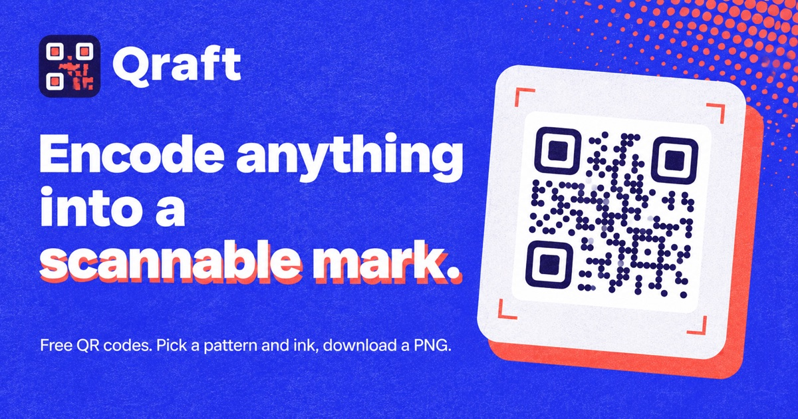

# Qraft

Encode anything into a scannable mark — a free, custom QR code generator built with Next.js.

## Features

- 5 pattern styles — Squares, Dots, Rounded, Classy, Elegant
- 6 color presets — Classic, Indigo, Ocean, Emerald, Rose, Violet
- 3 size options — Small (150px), Medium (200px), Large (280px)
- PNG download — high-quality 2x resolution export
- Real-time preview — instant QR code generation as you type
- Smooth animations — scan-line reveal and micro-interactions with Framer Motion
- SEO ready — structured data, sitemap, robots.txt, Open Graph & Twitter cards
- Hardened headers — CSP, HSTS, X-Frame-Options, and more

## Author

**Ashutosh Swamy**

- [Portfolio](https://ashutoshswamy.in)
- [GitHub](https://github.com/ashutoshswamy)
- [LinkedIn](https://linkedin.com/in/ashutoshswamy)
- [X](https://x.com/ashutoshswamy_)

## License

MIT — see [LICENSE](LICENSE) for details.
